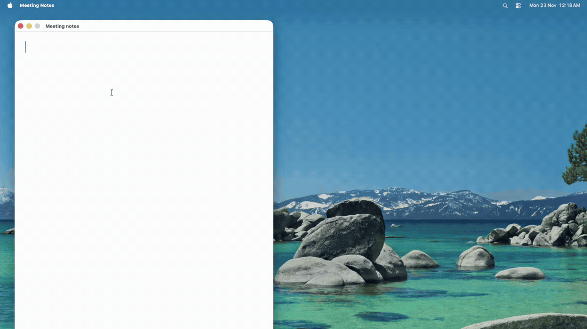

# AgentSpace

**Let an agent use your Mac while you keep working.**

AgentSpace lets a computer-use agent drive apps in the background, through
Accessibility, headless Chrome or its own virtual display. Your mouse, keyboard
and front app stay yours.



## How it works

Each workspace uses one of three control methods:

| Method | Used for | How it controls the app |
|---|---|---|
| CDP | Chrome web tasks | Headless Chrome with a disposable profile |
| Accessibility (AX) | Native app controls and text | Accessibility actions, value writes, and app-targeted keys |
| Virtual display | Coordinates, hover, drag, and scrolling | An AgentSpace-owned display and helper process |

The default `auto` route uses CDP for Chrome and AX for native apps. Pass
`--interaction visual` to use the virtual display. A workspace keeps its route,
and unsupported actions return an error instead of switching methods.

Every command returns JSON with the method used, whether the result was
verified, and the front app and cursor before and after.

## Results

Tested against two other computer-use tools while a scripted human typed and
moved the mouse. A workflow passes only if the task was verified **and** the
human's text, front app, cursor and cleanup checks all passed.

| Tool | Cold start | Warm start |
|---|:---:|:---:|
| **AgentSpace** | **18/18** | **18/18** |
| OpenComputer | 3/15 | 3/15 |
| SpaceO | 6/9 | 9/9 |

Each tool was scored only on the scenarios it supports, so the totals differ.
AgentSpace was faster on the Chrome form and slower on TextEdit. See
[Evals/RESULTS.md](Evals/RESULTS.md) for per-scenario results, speed and
memory, and [Evals/README.md](Evals/README.md) to run the evals yourself.

## Quick start

Requires macOS 14+, Swift 6 and Google Chrome.

```sh
git clone https://github.com/pradyuns/AgentSpace.git
cd AgentSpace
swift build -c release
export PATH="$PWD/.build/release:$PATH"
agentspace self-test
```

Headless Chrome needs no permissions. For native apps, give your terminal
Accessibility access (and Screen Recording for screenshots) in
**System Settings > Privacy & Security**. If you move the binaries, keep
`agentspace-display-host` next to `agentspace`.

Fill a web form without opening a visible browser:

```sh
agentspace create-workspace --workspace web
agentspace launch-app --workspace web --app chrome --file Fixtures/test-page.html
agentspace type-text --workspace web --role AXTextField --title 'Probe input' --replace --text 'Hello'
agentspace click --workspace web --role AXButton --title 'Probe button'
agentspace observe --workspace web --screenshot
agentspace stop-workspace --workspace web
```

Use a virtual display for visual interaction:

```sh
agentspace create-workspace --workspace visual --interaction visual
agentspace launch-app --workspace visual --app chrome --file Fixtures/interactions.html
agentspace observe --workspace visual --screenshot
agentspace stop-workspace --workspace visual
```

Use the screenshot to choose window-local points for `click --x X --y Y`,
`move --x X --y Y`, or `drag --x X --y Y --to-x X --to-y Y`.
Chrome coordinates target page content, not the browser toolbar.

### Connect an agent through MCP

Start the stdio MCP server:

```sh
agentspace mcp
```

Configure your MCP client to run the built `agentspace` executable with
`mcp` as its argument. Each CLI command is also an MCP tool with the same
options and JSON results.

## Commands

Every command accepts `--workspace NAME` and returns one JSON object.
CLI failures return a nonzero exit code.

| Command | Purpose |
|---|---|
| `create-workspace` | Create workspace state |
| `launch-app` | Launch TextEdit, Safari, Chrome, or an installed bundle ID |
| `prepare` | Create a workspace with visible Chrome before you start work |
| `observe` | Read the UI; add `--screenshot` to capture it |
| `click`, `type-text`, `key`, `scroll` | Act on a UI element |
| `move`, `drag` | Use visual pointer actions |
| `target-window` | Select a workspace window |
| `get-status` | Inspect routing, permissions, readiness, and recent actions |
| `stop-workspace` | Quit owned apps, release the display, and remove temporary files |
| `list-workspaces`, `self-test` | List workspaces or check prerequisites |

Common options:

| Option | Meaning |
|---|---|
| `--backend auto\|cdp\|ax\|virtual-display` | Select a route at first launch |
| `--interaction semantic\|visual` | Declare the interaction needed |
| `--app`, `--file`, `--url` | Choose the app and content to open |
| `--ref` or `--role` with `--title` / `--label` | Address a control from `observe` |
| `--text TEXT --replace` | Replace an editable value and check the result |
| `--key return` / `--key cmd+a` (native apps) | Send a key or supported shortcut |
| `--x`, `--y`, `--to-x`, `--to-y` | Use window-local visual coordinates |
| `--button right` / `--count 2` | Request a right-click or double-click |
| `--direction down --amount 1` | Scroll a selected area |

## Limitations

- Native control only works as well as the app's Accessibility support.
- The virtual display relies on private Apple APIs that can change between
  macOS releases. `agentspace self-test` checks whether they're available.
- Not a sandbox!!

## License

[MIT](LICENSE)
